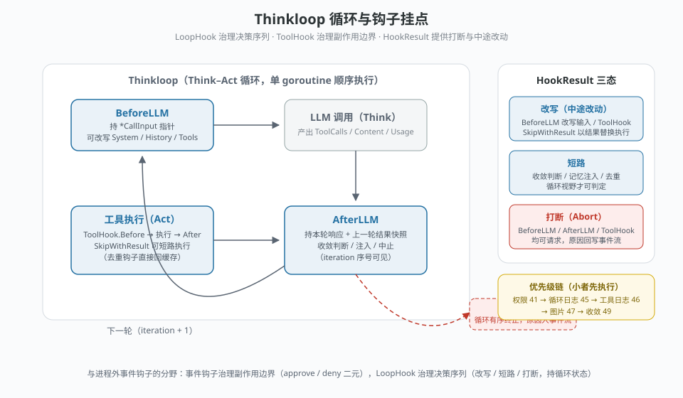

# Thinkloop 钩子系统

> goharness 的钩子（`core/goharness/hooks`）是**进程内的循环拦截器**：挂在 Think–Act 循环的迭代边界与工具执行边界上，持有循环的一等状态（输入指针、结果快照、迭代序号），可以对决策序列做**改写、短路、打断**三种干预。
>
> 它与 Claude Code / Cline 一类的事件钩子（进程外 spawn 命令、stdin/stdout 传 JSON、exit code 决定放行与否）原理相似，但能力与定位不同：事件钩子治理**副作用边界**（approve / deny 二元），本系统治理**决策序列本身**。



## 挂点总览

单次 `Run` 内由 goagent 内核顺序调用，全程单 goroutine，钩子链无需加锁：

```
BeforeLLM → LLM 调用 → 工具执行（ToolHook.Before → 执行 → After）→ AfterLLM → 下一轮
```

- **LoopHook** 挂在迭代边界：`BeforeLLM`（下一轮 LLM 输入成形处）与 `AfterLLM`（本轮响应与上一轮工具结果快照在手处）。
- **ToolHook** 挂在副作用边界：每个工具执行的前后。

## LoopHook — 治理决策序列

```go
type LoopHook interface {
    Priority() int
    BeforeLLM(sessionID string, iteration int, input *CallInput) HookResult
    AfterLLM(sessionID string, iteration int, resp *LLMResponse, results []ToolResult) HookResult
    Abort(sessionID string, reason string)
}
```

- `BeforeLLM`：持有 `*CallInput` 指针（SystemPromptSections / UserMessage / History / Tools）。**改写即生效**——修改 SystemPromptSections 后由适配器写回内核消息序列，下一轮 LLM 请求可见。典型实现：MemoryThoughtHook 按轮次注入项目记忆。
- `AfterLLM`：持有本轮 LLMResponse（Content / Reasoning / ToolCalls / TokenUsage）与上一轮工具结果快照。`iteration` 序号让钩子拥有循环轨迹视野——收敛判断、按轮次分级的策略只有在这里可实现。
- `Abort`：循环异常收尾（`hook_abort:xxx` / `max_iterations` / `error:xxx`）时的通知回调，LIFO 顺序执行。

## ToolHook — 治理副作用边界

```go
type ToolHook interface {
    Priority() int
    Before(sessionID string, toolName string, params map[string]any) HookResult
    After(result *ToolResult) HookResult
    Abort(reason string)
}
```

权限检查、日志、图片提取（`ImageHook` 把二进制图片转成独立消息块，不混入文本结果）、文件修改守卫都落在这层。

## HookResult — 三种干预

| 干预 | 字段 | 语义 |
| --- | --- | --- |
| 改写 | 修改入参指针（`*CallInput` / `*ToolResult`） | 中途改动后续流程可见的内容 |
| 短路 | `SkipWithResult *ToolResult` | 跳过工具执行，直接以提供的结果替换——去重钩子借此在不重复执行的情况下返回缓存 |
| 打断 | `Abort` + `AbortReason` | 有序终止循环；AfterLLM 中止时答案是本轮 LLM 内容，BeforeLLM 中止为空 |

## 优先级

数值越小越先执行，同轮内按此序串行：

```
权限 41 → 循环日志 45 → 工具日志 46 → 图片 47 → 收敛 49
```

优先级让钩子之间形成编排：权限钩子先于一切；收敛钩子垫底，等前面的检查都放行后才轮到它裁决本轮是否继续。

## 内置实现

| 钩子 | 层 | 优先级 | 职责 |
| --- | --- | --- | --- |
| `ConvergenceHook` | Loop | 49 | 收敛裁决：本轮是否继续 |
| `LoopLoggerHook` | Loop | 45 | 循环轨迹日志 |
| `ToolLoggerHook` | Tool | 46 | 工具执行日志 |
| `ImageHook` | Tool | 47 | 工具产出的图片转独立视觉消息 |
| `FileModifyHook` | Tool | 可配 | 文件修改守卫 |
| `MemoryThoughtHook` | Loop（mindx 侧装配） | — | 按轮次向 SystemPromptSections 注入项目记忆 |

## 内核桥接语义（改写生效的关键）

`agents/loop_hook_adapter.go` 把本钩子体系适配到 goagent 内核。两条最容易踩坑的语义：

1. **写回时机**：BeforeLLM 对 SystemPromptSections 的修改必须写回内核消息序列（共享底层数组），修改才对下一轮 LLM 请求可见；若只改本地拷贝，修改只停留在钩子内部。
2. **注入时机**：要在"进入内核内存消息之前"注入的内容（如重复错误引导话术），必须由工具执行适配器在返回值层面注入——回写期的修改只影响持久化，不影响下一轮 LLM 请求。注入晚一拍，效果就完全丢失。

## 设计边界

事件钩子与循环钩子不是替代关系，是两种治理对象：

- 工具副作用边界是天然事件（文件写了、命令跑了）——进程外事件钩子够用，且隔离性好。
- 循环内的决策点没有离散事件可挂——"下一轮输入该是什么""这轮要不要收敛""结果能否短路"——但恰恰是治理最该发生的位置。把治理点与决策点重合，是本系统存在的理由。
