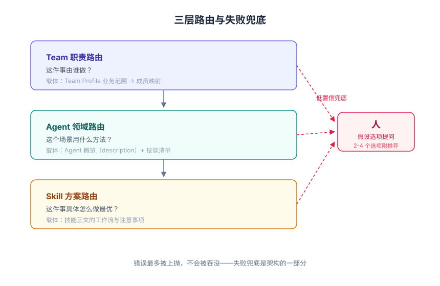
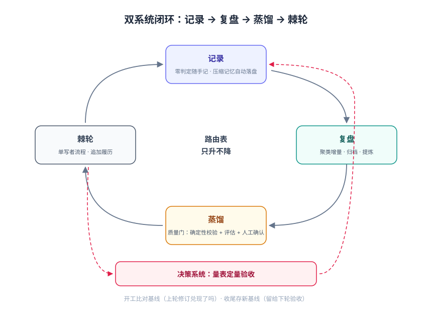
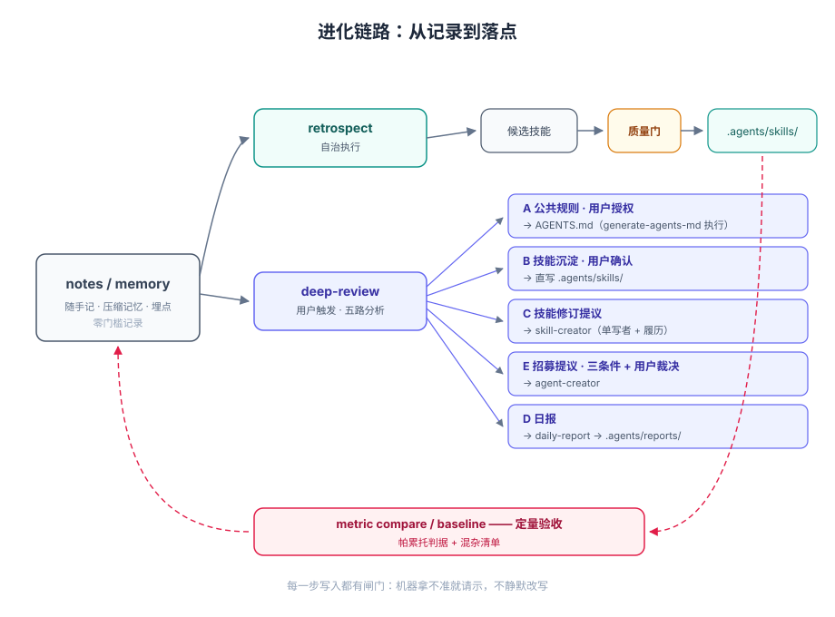
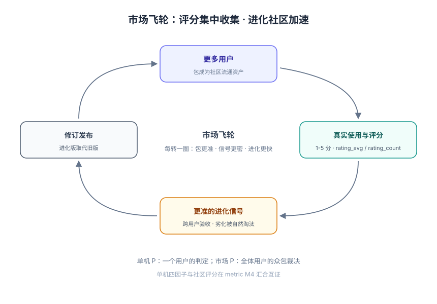

# MindX 进化机制与决策系统

本文是 MindX 进化机制与决策系统的定稿文档，覆盖原理、架构、特性、用法。一切状态描述以代码实现为准（实证载体：mindx daemon，goharness / mindx / mindx-work / mindx-desktop）。

上游理论：《决策路由：Agent 生态系统的第一性原理》（论证）、《决策量表：Agent 生态的绩效系统》（设计蓝图）、《决策量表_计量体系集成开发方案》（工程实施方案）。设计动机的完整论证在上游论文，本文不重复。

---

## 1 这套系统是什么

MindX 是一个 Agent 生态：Team 下辖多个 Agent，每个 Agent 携带一组技能。它的核心竞争力不是功能数量，而是**决策路由的精度**——面对一个任务，选对执行者、选对方法、选对方案的准确程度。

路由表（提示词形式的 Team 定义、Agent 概览、技能描述）会过时：新场景涌现、旧流程腐化、依赖变更。进化机制负责让路由表**只升不降**；决策系统负责**量化验收**每一次升级是否真的有效。两者合起来是一个可自检的闭环：经验被记录、被提炼、被固化为路由表条目，再被计量验证——改良没有兑现为量表改善，就回到复盘重查。

市场体系（mindx-work 已集成 mindx-market）进一步把这套闭环从单机扩展到社区规模：评分由市场集中收集，进化由社区加速，见第 6 节。

---

## 2 原理

### 2.1 决策归约

Agent 的一切操作——工具调用、任务规划、多智能体协作、记忆检索、上下文压缩——最终都归约为"在可能的决策路径中选择"。由此得出设计准则：**系统的竞争力等于决策路由的精度**。精度高的系统以更少的轮次、更低的 token 成本、更少的返工交付同样的结果。

### 2.2 三层路由

决策的组合爆炸靠分层对抗，每层只回答本层的问题：

| 层级 | 回答的问题 | 载体 |
| --- | --- | --- |
| Team 职责路由 | 这件事**由谁做**？ | Team Profile 的业务范围→成员映射 |
| Agent 领域路由 | 这个场景**用什么方法**？ | Agent 概览（description）+ 技能清单 |
| Skill 方案路由 | 这件事**具体怎么做最优**？ | 技能正文的工作流与注意事项 |



三层都无法给出确定答案时，路由终点是**人**：Agent 以假设选项（2-4 个具体选项附推荐）向用户提问，而不是在低置信状态下硬选。失败兜底不是缺陷补丁，是架构的一部分——错误最多被上抛，不会被吞没。

### 2.3 软实现

路由表是提示词，路由器是 LLM 本身。行为规则不编译进二进制，而是以可编辑文本存在（AGENTS.md、技能描述、SOUL.md），因此获得三个性质：**热更新**（编辑即生效）、**可审计**（可 diff、可评审）、**可进化**（更新协议因此可能）。装载天然分片——Team 小表常驻、Agent 概览按需发现、技能正文命中才加载——决策精度与 token 成本变成可设计的工程参数。

### 2.4 更新协议：双系统闭环

记录系统（低门槛、自动）+ 进化系统（人工触发、严格把关），四段闭环：



1. **记录**：工作过程中随手写低置信素材（决策、踩坑、缺口、待办），会话压缩产物由内核自动落盘为记忆；
2. **复盘**：聚类增量、去存量归档、提炼公共规则与候选技能；
3. **蒸馏**：候选经验过质量门（确定性校验 + 评估 + 人工确认）才落位为技能、规则或角色；
4. **棘轮**：修订一律走单写者流程并追加履历，被拒绝的方案连同理由留档——路由表要么变好，要么留下不变的理由，不存在静默劣化。

闭环的定量半边由决策系统补上：复盘开工前比对基线（上轮修订在量表上兑现了吗），收尾时存新基线（留给下轮验收）。

---

## 3 架构

### 3.1 进化能力全景



四个技能 + 两个内核系统，加一项社区设施：

| 组件 | 位置 | 职责 |
| --- | --- | --- |
| retrospect | runtime/skills | Agent 自身经验治理：notes/memory 聚类、去存量归档、候选技能质量门（自治执行） |
| deep-review | runtime/skills | 用户触发的项目复盘：五路分析（规则 / 技能沉淀 / 技能修订提议 / 招募提议 / 日报） |
| skill-creator | runtime/skills | 技能创建、审查、改进的唯一写者：校验、触发评估、输出评估、进化履历 |
| agent-creator | runtime/skills | Agent 与团队招募：先复用后创建、概览选择验证、编制设计 |
| 决策系统（metric） | daemon 内核 | 采集 → 聚合 → 量表 → 判定 → 比对，全量客观计量（见 3.5） |
| 压缩记忆系统 | daemon 内核 | 会话压缩产物逐条落盘 memory，确定性记录源 |
| mindx-market | 独立服务（mindx-work 已集成） | 包分发与社区评分收集，进化从单机扩展到社区（见第 6 节） |

### 3.2 目录体系

进化活动全部发生在项目目录的 `.agents/` 下，目录即协议：

```text
<project>/.agents/
├── notes/          # 随手记：决策/踩坑/缺口/待办，四元组命名（记录时间-agent名-分类-标题）
├── memory/         # 群体经验池：notes 经复盘聚类后的长期沉淀 + .archive/ 归档
├── skills/         # 项目级技能库：复盘蒸馏与手工创建的技能落点
│   └── <name>/     # SKILL.md + scripts/ + references/ + evals/ + notes/（进化履历）
├── references/     # 外部权威资料原文：ref_XXX/（meta.json + 原文），index.csv 引用索引
└── reports/        # 复盘日报（daily-report 技能落点）
```

文件名即索引：notes 与 memory 按记录时间天然可排序，`ls -t` 加分类筛选完成一次粗粒度路由，无需检索引擎。项目目录整体可打包迁移，工作经验随目录带走。

### 3.3 记录：三源结构

| 源 | 性质 | 内容 | 门槛 |
| --- | --- | --- | --- |
| notes 随手记 | 概率性（Agent 依提示词自觉） | 决策、踩坑、缺口分类、待办 | 零判定，记录即沉淀 |
| 压缩记忆 | 确定性（内核在压缩时机自动落盘） | 会话过程记忆 | 无 |
| metric 埋点 | 确定性（会话生命周期钩子） | 工具/技能调用流、用量、判定 | 无 |

缺口记录使用标准词汇表——常规类（决策/踩坑/经验/事实/待办/偏好）与缺口六类（触发遗漏/规则缺失/指令冲突/流程漏洞/输出格式/版本兼容）。缺口六类同时是**路由故障分类学**：每条缺口记录就是一次对路由表的精确报错。

### 3.4 进化链路



链路上的每一步写入都有闸门：技能过 validate 与评估，AGENTS.md 修订走用户授权，Agent 招募过三条件与用户裁决。进化系统的人工触发是刻意保留的关口——机器遇到拿不准的地方请示，不静默改写。

### 3.5 决策系统（metric）

五层管线容纳于 mindx daemon——它是全部会话、全部 Agent、全部技能调用的唯一全局观察点：

```text
采集层（会话生命周期钩子自动埋点）
  → 标注层（用户反馈 > Agent 收尾上报 > 中性不计；判定带版本、可回溯修正）
  → 聚合层（Go 确定性计算，禁止 LLM 心算）
  → 存储层（daemon 本地，明细滚动保留、聚合永久）
  → 服务层（CLI 面向 Agent + RPC 面向壳，双面同一真相）
```

计量框架：四因子 **Q**uality（任务成功率/返工率/路由修正）× **S**peed（轮数/时延，分位数呈现）× **Y**ield（产出无修正采纳率）× **E**ffort（token/成本/上下文/子任务数），加第五维度 **P**（轮次赞踩与管理页评价的人类判定）。P 与 Q 独立呈现——会聚则可信，背离即最高价值的诊断信号（Q 高 P 低修体验，Q 低 P 高防乐观偏差）。

四因子**不合成单一总分**：并列呈现让短板自明，同时消灭最容易被 gaming 的目标形态。

实现状态：

| 组成 | 实现 | 状态 |
| --- | --- | --- |
| 采集层 | 会话生命周期钩子自动埋点 | 已落地 |
| 聚合层 | Go 确定性计算；S/E/Q 出数，null 显式标注 + 覆盖率随样本自适应 | 已落地 |
| 判定层 | 三入口：壳侧轮次赞踩（round.rating）、管理页评价（agent.rate）、Agent 收尾上报（RPC `metric.record`）；判定版本链支持回溯修正；文本感受汇入 notes | 已落地 |
| 服务层 | CLI `report` / `baseline save` / `baseline list` / `compare` + RPC 面向壳 | 已落地 |
| 复盘集成 | retrospect Full 模式开工 `compare` 收尾 `baseline save`；skill-creator 审查 `report --skill` 互证 | 已落地 |
| Y/P 呈现 | 判定层已收数，聚合呈现 null 占位 | 随 v2 交付 |
| 市场出网 | 本地四因子与市场众包评分互证 | 随 M4 交付 |

---

## 4 特性：设计纪律

这些纪律是防腐蚀的，每一条都对应一种已知的失效模式：

1. **单写者原则**。技能修订只出自 skill-creator（附进化履历 notes/），AGENTS.md 修订只出自 generate-agents-md，Agent 创建只出自 agent-creator；复盘对存量只产出提议。多写者是格式漂移与履历断链的根源。
2. **棘轮**。候选技能须在确定性校验与评估中取得高于旧版的评分才落位；连续无提升即停止迭代。路由表只升不降。
3. **零判定随手记**。记录阶段不做"值不值得记"的判断，价值筛选交给复盘——低门槛保住单次踩坑，技能化是少数派福利。notes 只增不删，溯源链不断。
4. **用户信号覆盖**。判定优先级恒为：用户反馈 > Agent 上报 > 中性不计。Agent 的"诚实"不被信任，结构校验替代动机假设。
5. **Goodhart 防线**。不合成总分、四因子互相制衡（优化速度必然推高成本，gaming 代价内生）、用户信号优先、量表只喂进化不接奖惩。另有一条本生态独有的**反应性条款**：聚合分数默认只进复盘通道，不进 Agent 日常上下文——Agent 知道存在计量，不知道自己每项的具体分数，无从针对性伪装。
6. **覆盖率诚实**。无判定的指标输出 null 并声明覆盖率，禁止小样本冒充统计；下钻深度随样本量自适应。
7. **作用域隔离**。技能与经验绑定项目目录，不跨项目自动共享；上涌（项目级→全局）走人工裁决，防领域污染。
8. **外部引用只取公理**。笔记与技能引用外部权威结论时标注 `[ref:条目ID]` 指向 references/ 的原文，不搬二手转述，不粘贴原文。

---

## 5 用法

### 5.1 日常执行（Agent 侧，零操作）

- **随手记**：执行中发现值得记的信息直接写入 `.agents/notes/`，会话结束前扫一眼补记遗漏；
- **记忆寻回**：新会话或任务缺历史背景时，`ls -t .agents/memory/` 按时间与分类取相关条目，深检索用 Grep；他人记忆仅作旁证；
- **公理查询**：引用外部结论先查 `references/index.csv`。

### 5.2 复盘（用户触发）

对 Agent 说"复盘"（或"总结经验、沉淀规则"）即启动 deep-review：采集 notes/skills/memory → 五路分析 → 逐项征求授权 → 日报落盘。Agent 对自身经验的日常治理（聚类、归档、质量门）由 retrospect 自治执行，无需用户在场。

### 5.3 技能创建与进化

- 新技能：说"帮我创建一个处理 X 的技能"→ skill-creator（查重 → 选项确认 → 编写 → validate 自检 → 触发评估）；
- 审查既有技能："检查一下这个技能"→ 机器校验 + 正文审查 + 运行效果互证（`mindx metric report --skill <名>`）；
- 进化：对话回观或复盘提议触发，skill-creator 在项目级副本修订并追加履历，禁止直改全局库 `~/.mindx/skills`。

### 5.4 Agent 与团队招募

说"我需要一个 XXX 专家"→ agent-creator：本地与市场双重检索（能复用绝不新建）→ 技能与工具裁剪 → 创建 → 概览选择验证 → 雇佣。跨领域成建制需求走团队编制。复盘 E 路的招募提议经用户裁决后同样由此执行。

### 5.5 决策系统 CLI（需 daemon 运行）

```bash
mindx metric report [--agent <名>] [--skill <名>] [--window-days 7] --json  # 四因子+P 分位数量表
mindx metric baseline save <名> [--window-days 7]                        # 复盘收尾存基线
mindx metric baseline list                                               # 基线清单
mindx metric compare --baseline <名> --json                              # 开工前验收，帕累托判据 + 混杂清单
```

`compare` 退出码 0（改善）/ 1（持平或劣化）直接供复盘自动化；输出强制附带期间混杂清单（模型变更、路由表大版本变更、环境事件）——归因解读先看清单。判定的写入不走 CLI：壳侧轮次赞踩、管理页评价、Agent 收尾上报三个入口直连 daemon。

### 5.6 场景速查

| 我想… | 走哪里 |
| --- | --- |
| 记一条踩坑 | 随手写 `.agents/notes/`，零门槛 |
| 让经验变成技能 | 攒素材，复盘时走 B 路，或直接找 skill-creator |
| 修一条反复踩的坑对应的技能 | 复盘 C 路出提议 → skill-creator 修订 |
| 沉淀为项目规则 | 复盘 A 路出提议 → generate-agents-md 写入 |
| 补一个能力空缺的角色 | 复盘 E 路提议或直接找 agent-creator |
| 验收上轮复盘的效果 | `mindx metric compare --baseline` |
| 查某个技能的真实表现 | `mindx metric report --skill` |
| 看一个包的社区口碑 | 市场评分聚合（rating_avg / rating_count） |
| 让改良惠及社区 | 发布到市场，进化版取代旧版（见 6.2） |

---

## 6 市场飞轮：从单机进化到社区进化

mindx-work 已集成 mindx-market，Agent、Skill、Team、Plugin 从本地资产变成社区流通资产。第 2.4 节的闭环发生在单机与单项目内；市场把它放大成社区尺度的飞轮——**评分由市场集中收集，进化由社区加速**。

### 6.1 市场：评分的收集中心

每个用户对每个包的评分（1-5 分）上收到市场服务端，聚合为包级的 `rating_avg` / `rating_count`。服务端语义：

- **包级不区分版本**——评分挂在 kind + name 上，版本迭代不清零口碑；包的口碑是其全部历史的累积裁决；
- **双通道身份**——登录用户与匿名设备均可评分，设备绑定账号后评分迁移归并到 user 名下；
- **写入即聚合**——事务内重算冗余聚合列，读侧零成本取到最新口碑。

这与决策量表的关系：市场评分是 **P 维度（人类判定）的社区化形态**。单机 metric 的 P 是一个用户的判定，市场的 P 是全体用户对该包的众包判定——单机四因子回答"我的路由表精度如何"，市场评分回答"全生态如何裁决这个包"。

### 6.2 社区：进化的加速器

本地进化链路（记录 → 复盘 → 蒸馏 → 棘轮）产出改良包，发布到市场后**进化版取代旧版**。棘轮由此获得社区形态：

- **验收信号跨用户**——一个包在所有用户机器上的真实表现通过评分回流给作者，样本量远超单机盲评；作者按信号修订再发布，形成社区尺度的"修订 → 验收"循环；
- **劣化被自然淘汰**——评分与装机量随质量分化，进化快的包获得更多装机，原地踏步或劣化的包被边缘化；评分不随版本清零，口碑只增不减，与单机棘轮"只升不降"同构；
- **四类包同等适用**——Agent、Skill、Team、Plugin 走同一套市场评分与版本取代机制，社区成为所有路由表条目的共同进化场。

### 6.3 飞轮



两个尺度的闭环互为表里：

| 尺度 | 闭环 | 验收信号 | 状态 |
| --- | --- | --- | --- |
| 单机（第 2.4 节） | 记录 → 复盘 → 蒸馏 → 棘轮 | 本地 metric 四因子 | 已落地（Y/P 呈现随 v2 交付） |
| 社区（本节） | 使用 → 评分 → 修订 → 发布 | 市场评分聚合 | 评分服务端已实现，mindx-work 已集成 |

两个尺度在 metric M4 汇合：本地判定与市场评分双向打通（出网），单机四因子与社区众包评分互证——本地说好而社区说差的包，优先怀疑触发面与真实场景错位。

---

## 7 文档索引

| 文档 | 性质 |
| --- | --- |
| `决策路由-Agent生态系统的第一性原理.md`（仓库根） | 理论论证：三层路由、软实现、进化协议、可证伪性 |
| `决策量表-Agent生态绩效系统技术白皮书.md`（仓库根） | 计量设计：十一份公理、四因子推导、主观评测、设计纪律 |
| `决策量表_计量体系集成开发方案.md`（仓库根） | 工程实施：M0-M4 阶段、落点映射、横切纪律 |
| `目录局部技能进化系统_设计文档.md`（仓库根） | 记录与复盘的原始设计：即时沉淀、零判定、人工关口 |
| `mindx/runtime/skills/` 四技能 SKILL.md | 可执行的操作规范，本文用法的最终事实来源 |
