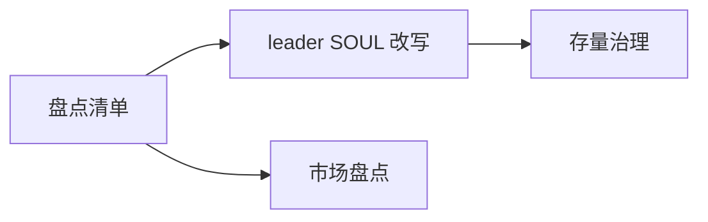

# 成文模板集

直接复制填充。模板内的 `<占位>` 按需替换，缺信息的项回对应步骤补齐，禁止留占位交付。

**落盘**：S2 计划把下面一、二、三三节写进同一个文件 `<项目>/.agents/plans/G-<编号>.md`（意图卡在上、计划正文居中、各任务书依次接在后面）；账本只存状态与指针，不重复正文。S1 只写本节「零」里的简版表格，S0 不落盘。

## 零、轻量档（S0 / S1）

**S0 清单直答**——不落盘、不入账，直接发在对话里：

```markdown
<N> 件事，按你说的顺序：
1. <任务>——<一句话做法>
2. <任务>——<一句话做法>

要落盘、要派人、要算工期，说一声我升级成正式计划。
```

**S1 简版计划**——落盘到 `.agents/plans/G-<编号>.md`，不入账：

```markdown
# 计划（轻量）：G-<编号> <目标标题>

| # | 任务 | 依赖 | 验收 | 预算 | 执行方（+依据来源） |
| - | ---- | ---- | ---- | ---- | ------------------ |
| T1 | <做什么> | — | <可检查> | 3 轮 | 自己做 |
| T2 | <做什么> | T1 | <可检查> | 4 轮 | <执行方>（来源：用户点名） |

合计 <N> 轮。按这个做，你说「行」就开工。
```

## 一、意图卡（第一步产出）

```markdown
## 意图卡：G-<编号> <目标标题>
- 收益方与场景：<谁受益，什么场景>
- 成功判据：<可数指标或可观察事件>
- 范围边界（不做）：<明确排除项，逐条>
- 含糊点：<逐条，每条一句可回答的问题；无则写"无">
```

## 二、计划文档（第二步产出）

```markdown
# 计划：G-<编号> <目标标题>

## 任务清单
| # | 任务 | 依赖 | 置信度 | 探测点数 | 档位 | 预算 | 执行方（+命中依据 + 来源） |
| - | -------- | ---- | ------ | -------- | ---- | ---- | ------ |

## 依赖图
<T1 → T2（原因）；并行组标注>

## 图示
<任务 ≥3 或有并行组才画，单任务小计划跳过本节。抽象概念用 mermaid，给用户看的计划必含：>


<结构类概念（模块划分/职责面）用 flowchart，流程类用 sequence；有图节就不再纯文字重述同一内容>

## 约束核对
<用户原话中的约束逐条列出，标注由哪个任务承接>
```

## 三、任务书（每任务规格，执行方只看它就能干活）

```markdown
# 任务书：G-<编号>-T<n> <任务名>

- 目标：<一句话说清要达成什么>
- 验收标准：<干成什么样算成，可检查>
- 上下文位置：<材料文件目录，绝对路径逐条>
- 产出与去向：<写到哪、给谁看>
- 预算：≤<N> 轮 / 约 <X>k tokens（含返工余量 1 轮；超预算先收结论再决策）
- 探测点清单：<逐条列名；自己动手档才必填>
- 依赖与前置：<前置任务的产出在哪>
```

## 四、摸底计划（档位 2 报用户审批用）

```markdown
## 摸底计划：G-<编号> <目标标题>
- 为什么要摸底：<探测的是哪个未知>
- 每批安排：
  - 批 1：<岗位> 查 <探测点清单>，预算 <N> 轮
  - 批 2：<岗位> 查 <探测点清单>，预算 <N> 轮
- 汇总方式：<各批产出落点与合并规则>
- 请用户确认：批准 / 调整批次数与预算
```

## 五、账本条目

见 SKILL.md「账本」节——高频必用，随正文走，不在本文件重复。
